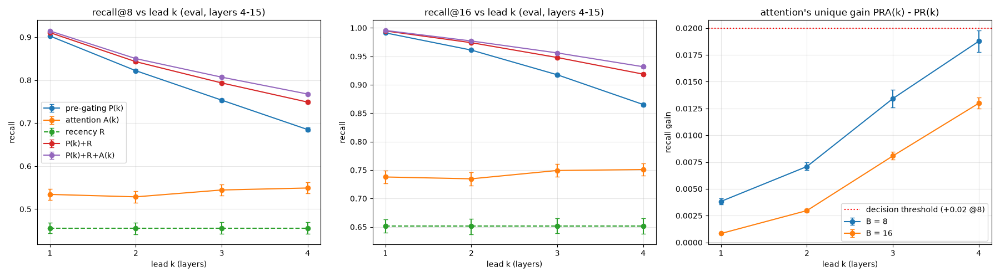
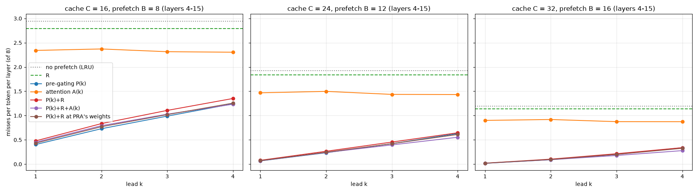

# Does attention predict MoE expert routing? (OLMoE-1B-7B)

## Verdict: mixed

- **Supported: attention predicts routing beyond distance.** Tokens that attend strongly to each other
  share more experts than other pairs at the same distance. Within a distance bin, Spearman
  ρ(attention, expert overlap) is 0.13–0.27 in layers 2–15 (averaged over bins), with CIs of about
  ±0.01. Controlling for exact distance, removing repeated tokens and dropping the attention sink each
  barely change it. As a predictor, same-layer attention (A) beats tuned recency by +0.069 recall@8.
  Previous-layer attention (B), which has usable lead time, beats it by about +0.088 (0.522 vs. 0.434).
- **Not supported in practice at one layer of lead (Step 2).** Training-free pre-gating gets 0.875
  recall@8 (0.976 @16), against ~0.50 for attention. Added to pre-gating + recency, previous-layer
  attention gains only **+0.0049 [+0.0046, +0.0052] recall@8** and **+0.0018 @16**. The gain is real
  but negligible:
  - At B = 8 it is positive in every layer (all domains pooled) and in every domain (layer average).
  - Per layer × domain it is often within noise of 0. At this one-layer lead it is probably not
  worth computing and transferring attention-derived scores for prefetch when pre-gating is
  available.
- **Weakly supported at longer lead (Step 3).** Predicting k = 1…4 layers ahead, pre-gating decays
  (recall@8 0.903 → 0.685, layers 4–15) while attention stays flat (≈ 0.53–0.55). Attention's unique
  gain over pre-gating + recency grows about 5× to **+0.0188 [+0.0178, +0.0198] recall@8 at k = 4**,
  just under REVIEW.md's +0.02 threshold. In an LRU offload simulator it cuts misses by **14–18% vs.
  pre-gating + recency at k = 4** (cache of 24–32 of 64 experts per layer), which meets the decision
  rule as written. (Against P(k)+R the rule is formally met at every k, but at k ≤ 2 that is an
  artefact of the reference's recency weight.) Against the strongest non-attention reference, the cut
  is 9–15% at k = 4 (C = 24–32) and 11% at k = 3 (C = 32). In absolute terms that is ≈ 0.06 misses
  per token per layer at k = 4, C = 24, vs. that reference (PRw(4); 0.09 vs. P(4)+R).
  So the prefetch hypothesis stays open, but only for multi-layer-ahead prefetch with fairly large
  caches. At k ≤ 2 attention adds little: against pre-gating alone its miss reduction is negative for
  C ≤ 24 and at most 2.6% at C = 32.

All numbers come from the eval split (150 of 300 sequences), with 95% bootstrap CIs over sequences.
Everything tuned or selected used the other 150 sequences (the selection split). Per-step details:
[`STEP0.md`](STEP0.md), [`STEP1.md`](STEP1.md), [`STEP2.md`](STEP2.md), [`STEP3.md`](STEP3.md).

## Setup
- **Model:** `allenai/OLMoE-1B-7B-0125`, bf16, eager attention, on a single L4. It has 16 layers, 64
  experts with top-8 routing, and 16 heads; `norm_topk_prob=False`. Peak GPU memory is 13.5 GB for a
  1024-token forward pass with all hooks.
- **Ground-truth expert sets:** the `top_k_index` captured by a forward pre-hook on each layer's
  `mlp.experts`. Top-8 of `output_router_logits` matches it for 100% of tokens in all layers.
- **Attention:** taken from the eager attention output via forward hooks and reduced inside the hook,
  so the full `[H, n, n]` tensor is never kept. Rows sum to 1 (within bf16 rounding of 3e-3), and the
  upper triangle is exactly 0.
- **Data:** 300 sequences × 1024 tokens, 100 per domain, all ungated and streamed (no substitutions):
  - web: FineWeb-Edu `sample-10BT`
  - code: `codeparrot/codeparrot-clean-valid`
  - math: `open-web-math/open-web-math`

  Each sequence is one document: `<|endoftext|>` plus its first 1023 tokens; shorter documents were
  skipped. That filter was strong: 100 were kept of 348 web, 190 code and 221 math documents scanned,
  so the data is biased toward long documents. Data uses 1.2 MB on disk. The split is 50/50 selection/eval, stratified by domain, seed 0
  (`split.json`).
- **Reproduce:** `python -m src.run_all` (data build if missing → split → Step 0 → Step 1 → Step 2 →
  Step 3). Steps 0–2 take 16.5 min on the L4 with data cached, and Step 3 takes about 23 min more. Seeds are fixed, and the data build is deterministic
  (byte-identical on rebuild). A final end-to-end rerun reproduced every Step 1/2 CSV and JSON
  byte-for-byte. That rerun predates Step 3, so Step 3 was not part of it.

### Deviations and decisions
- **Start token:** the tokenizer adds no BOS, so I prepend `<|endoftext|>`. Position 0 is therefore
  always the same token, so following REVIEW.md, "exclude j = 0" is the main variant everywhere.
- **`data.py` crash at exit:** the `datasets` streaming threads abort interpreter teardown with a
  `PyGILState_Release` fatal error. `del ds; gc.collect()` did not fix it, so the fix is `os._exit(0)`
  after saving (`data.hard_exit`).
- **NVML:** nvidia-smi is broken on this VM (driver/library version mismatch), but CUDA works. Memory
  was measured with `torch.cuda.max_memory_allocated`.
- **Additions from REVIEW.md:** the token-identity control, per-sequence bootstrap CIs, stratified
  pair sampling, the recency baseline, an exact pre-gating definition, z-scored combinations with
  selection-tuned weights, attention + recency, and pre-gating + recency + attention.
- **My own additions:**
  - a partial Spearman controlling for exact distance within each bin (Step 1);
  - an oracle (the router's own logits) as a sanity check;
  - B's heads (layer l−1) ranked by B's own selection-split recall, added after review.
- **Tuning scope:** all tuned parameters are per layer. The objective is mean recall over
  B ∈ {8, 12, 16, 24, 32}.
- **Pre-gating lead time:** TASK.md labels pre-gating "a full layer" of lead. Its real lead is layer
  l's attention block only: it needs the residual after layer l−1. Previous-layer attention (B) is
  available slightly earlier, after layer l−1's attention.
- **Token range:** recall is measured over tokens t ∈ [2, 1024). Token 0 has no history, and token 1's
  only key is the sink.

## Step 1: does attention predict expert overlap beyond distance?
**Method.**
- For each sequence and each log-spaced distance bin, I take all d = 1 pairs, or up to 2000 sampled
  pairs. The same pairs are used for every layer.
- I compute Spearman ρ between a(t, j) and |E_t ∩ E_j| / 8 per sequence, then average over sequences.
- Main variant: j = 0 excluded and ids[t] ≠ ids[j]. Full tables: `STEP1_tables.md`, `step1_corr.csv`.

**Head-mean attention, eval:**

| layers | ρ, mean over bins d ≥ 2 | notes |
|---|---|---|
| 0–1 | 0.02–0.05 | signal only at short range (d ≤ ~8), decaying to ~0; layer 0 turns negative at long range (−0.10) |
| 2–8 | 0.18–0.27 (peak: layer 5, 0.268) | peak at d = 2–4 (up to 0.36), still 0.14–0.21 at d = 513–1023 |
| 9–10 | 0.13–0.16 | |
| 11–15 | 0.18–0.24 | |

- **Beyond distance:** within a bin, the partial ρ given the exact d stays within ~0.003 of ρ when
  averaged over bins. Single cells differ by ≤ 0.03.
- **d = 1 is the blind spot:** at d = 1, ρ is weak or negative in middle layers (down to −0.13). Nearly
  every token attends heavily to its predecessor, so attention doesn't separate tokens there. Locality
  carries that case (mean overlap 0.36–0.50 at d = 1 in layers 2–15).
- **Controls barely matter:** same-token pairs are only 0.7–3.4% of pairs, and removing them lowers ρ
  by ~0.01. Excluding the sink barely changes pair-level ρ, because few sampled pairs have j = 0.
- **Domains:** similar across domains. Code is strongest in layers 8–13, math leads in layers 14–15,
  and web is the weakest.
- **Heads:** a handful of heads carry a stronger signal than the layer average, but most heads in
  layers 2–15 are positive.
  - Top heads, ranked on the selection split and scored on eval: 5.6 (0.350), 14.12 (0.350),
    6.2 (0.345), 5.3 (0.344), 2.2 (0.310).
  - The best head beats its layer's head-mean by up to +0.14. In layers 11–13 the best head is within
    +0.02 of the head-mean.
  - Selection vs. eval head ranks agree almost perfectly (Spearman 0.999). That reflects stable head
    behaviour; the splits are disjoint documents, so it isn't leakage.
  - Head 0.4 is strongly negative (−0.25 [−0.27, −0.24]; −0.30 on web).

## Step 2: is attention useful for prefetch?
recall@B = |top-B prediction ∩ true top-8| / 8. The table shows the eval split, all domains, averaged
over layers 1–15, with 95% CI. Per-layer and per-domain tables are in `STEP2_tables.md`; the full data
is in `step2_recall.csv`.

| predictor | lead time | recall@8 | recall@16 |
|---|---|---|---|
| random | — | 0.125 | 0.250 |
| frequency (j < t) | before token t | 0.397 [0.383, 0.412] | 0.581 [0.566, 0.597] |
| prev-token | before token t | 0.425 [0.417, 0.434] | 0.637 [0.627, 0.650] |
| recency (λ tuned) | before token t | 0.434 [0.422, 0.445] | 0.627 [0.615, 0.638] |
| A: same-layer attention, head-mean | ≈ none | 0.474 [0.461, 0.487] | 0.683 [0.670, 0.695] |
| A: same-layer attention, top-3 Step 1 heads | ≈ none | 0.501 [0.489, 0.514] | 0.704 [0.693, 0.715] |
| A: head set chosen per layer (top-3 or mean) | ≈ none | 0.503 [0.489, 0.515] | 0.708 [0.696, 0.720] |
| A, head-mean, sink included | ≈ none | 0.327 [0.311, 0.341] | 0.607 [0.591, 0.622] |
| A, top-3, sink included | ≈ none | 0.391 [0.376, 0.407] | 0.643 [0.628, 0.659] |
| B: prev-layer attention, 3 recall-ranked heads | ~1 layer | 0.522 [0.509, 0.535] | 0.721 [0.710, 0.733] |
| B, head-mean | ~1 layer | 0.472 [0.459, 0.485] | 0.680 [0.667, 0.692] |
| B, 3 heads, sink included | ~1 layer | 0.438 [0.424, 0.451] | 0.672 [0.658, 0.685] |
| B, head-mean, sink included | ~1 layer | 0.344 [0.329, 0.359] | 0.610 [0.594, 0.625] |
| recency + A | ≈ none | 0.507 [0.495, 0.520] | 0.712 [0.700, 0.723] |
| recency + B | ~1 layer | 0.525 [0.513, 0.538] | 0.725 [0.713, 0.737] |
| **pre-gating** | layer l's attention block | **0.875 [0.873, 0.877]** | **0.976 [0.975, 0.976]** |
| pre-gating + A | ≈ none | 0.888 [0.886, 0.889] | 0.982 [0.982, 0.983] |
| pre-gating + B | layer l's attention block | 0.888 [0.887, 0.889] | 0.983 [0.983, 0.983] |
| pre-gating + recency | layer l's attention block | 0.885 [0.884, 0.887] | 0.982 [0.982, 0.983] |
| pre-gating + recency + A | ≈ none | 0.890 [0.888, 0.891] | 0.984 [0.983, 0.984] |
| **pre-gating + recency + B** | layer l's attention block | **0.890 [0.889, 0.892]** | **0.984 [0.984, 0.984]** |
| oracle (router logits, sanity check) | — | 1.000 | 1.000 |

Pre-gating and B are undefined at layer 0, because there is no layer −1. They are reported as N/A there
in `STEP2_tables.md`, which is why all averages cover layers 1–15. "Sink included" keeps the attention
to j = 0 (a constant `<|endoftext|>` token). The main variants drop it and renormalize.

**Does attention beat pre-gating?** No, by a wide margin: A − P = −0.373 [−0.388, −0.357] @8. This holds
in every layer and domain; even code, where attention is strongest, gives −0.276.

**Does it add to pre-gating?** Only marginally. All gains below are paired per sequence, eval, averaged
over layers 1–15:

| comparison | gain@8 | gain@16 |
|---|---|---|
| attention adds to recency (R+A − R) | +0.073 [+0.071, +0.076] | +0.085 [+0.082, +0.088] |
| prev-layer attention adds to pre-gating (P+B − P) | +0.013 [+0.012, +0.014] | +0.007 [+0.007, +0.008] |
| recency adds to pre-gating (P+R − P) | +0.010 [+0.009, +0.011] | +0.007 [+0.006, +0.007] |
| **prev-layer attention adds to P+R (P+R+B − P+R)** | **+0.0049 [+0.0046, +0.0052]** | **+0.0018 [+0.0017, +0.0020]** |
| same-layer attention adds to P+R (P+R+A − P+R) | +0.0043 [+0.0041, +0.0045] | +0.0015 [+0.0014, +0.0016] |

- **By domain (P+R+B − P+R @8):** code +0.0069, math +0.0044, web +0.0034.
- **By layer:**
  - The gain is largest in early layers, where pre-gating is weakest (layers 1, 2, 4: pre-gating
    0.67–0.82, gain +0.010 to +0.014).
  - It is smallest in layers 12–14, where pre-gating is 0.94–0.95 @8 (gain +0.0003 to +0.0012).
  - Layer 1 is where pre-gating is weakest (0.67). There, P+R+B gives 0.702, but most of that gap is
    recency: P+R alone is 0.691, so attention's own term is +0.011.
- **Sink handling is essential:** dropping j = 0 and renormalizing adds +0.148 recall@8 to head-mean A.
  With the sink included, both A variants fall below recency, and the best B variant only matches it
  (0.438 vs. 0.434).
- **Lead time:** the previous layer (B) is at least as good as the same layer (A), which has ≈ no
  usable lead. See the caveat on head selection under Limitations.

## Step 3: matched lead time, k = 1…4, and an offload simulator
Details: [`STEP3.md`](STEP3.md), tables in `STEP3_tables.md`.

**Setup.**
- **Lead k:** a predictor of token t's experts at layer l may use only what exists once layer l−k has
  finished for token t, plus anything from earlier tokens.
- **Predictors:**
  - P(k) = residual after layer l−k → layer l's norm and gate.
  - A(k) = layer l−k attention (sink excluded) × E_j^l. The top-3 heads of layer l−k are ranked by
    A(k)'s own selection recall; top-3 beat the head-mean in every (k, l).
  - R = recency.
  - P(k)+R and P(k)+R+A(k), with weights tuned per (k, l) on the selection split.
- **k = 1 check:** k = 1 reproduces Step 2's pre-gating, B and both combinations exactly (max |Δ| = 0
  per sequence).
- **Simulator:** an LRU cache per layer with C ∈ {16, 24, 32} of 64 experts. Before each token, the
  predictor's top C/2 is prefetched. Misses and loads are counted over layers 4–15. One expert is
  12.58 MB.

**Recall vs. lead (eval, layers 4–15, same layers for every k):**

| predictor | k=1 @8 | k=2 @8 | k=3 @8 | k=4 @8 | k=4 @16 |
|---|---|---|---|---|---|
| P(k) pre-gating | 0.903 | 0.822 | 0.753 | 0.685 | 0.865 |
| A(k) attention | 0.534 | 0.528 | 0.544 | 0.549 | 0.751 |
| R recency | 0.456 | 0.456 | 0.456 | 0.456 | 0.651 |
| P(k)+R | 0.911 | 0.843 | 0.793 | 0.749 | 0.919 |
| P(k)+R+A(k) | 0.914 | 0.850 | 0.807 | 0.768 | 0.932 |
| **unique gain of A(k)** | **+0.0038 [+0.0036, +0.0041]** | **+0.0071 [+0.0067, +0.0075]** | **+0.0134 [+0.0126, +0.0142]** | **+0.0188 [+0.0178, +0.0198]** | +0.0130 [+0.0125, +0.0135] |

- **CIs:** at @8 the half-widths are ±0.0015–0.0045 for P and the combinations and ±0.013 for A and R.
  Every cell's CI is in `STEP3_tables.md`.
- **Layer range:** the k = 1 column averages layers 4–15. Over all l ≥ 1 it equals Step 2 exactly:
  pre-gating 0.875 and gain +0.0049 (`avg_defined` in `STEP3_tables.md`).

- Attention's information does not decay with lead, pre-gating's does (≈ −0.07 recall@8 per layer).
  So attention's unique contribution grows with k.
- At k = 4 even attention alone is still far below pre-gating (−0.136 @8), except in code (−0.026).
- **By domain (@8):**
  - k = 4: code +0.0238, math +0.0190, web +0.0135.
  - k = 2: code +0.0084, math +0.0074, web +0.0054.
  - The order is the same at every k.
- **Per layer:**
  - k = 2: +0.021 in layer 3 (the only layer above +0.02), +0.010 to +0.019 in layers 2–7, and
    +0.001 to +0.007 in layers 8–15.
  - k = 4: above +0.02 in layers 4–7, 9 and 10 (max +0.037 in layer 5), and +0.004 to +0.015
    elsewhere.

**Offload simulator (misses per token per layer, of 8; eval, layers 4–15):**

| predictor | C = 16 | C = 24 | C = 32 | experts moved per token, C = 24 | MB per token, C = 24 |
|---|---|---|---|---|---|
| no prefetch (LRU) | 2.94 | 1.92 | 1.19 | 23.1 | 291 |
| R | 2.79 | 1.83 | 1.14 | 22.0 | 277 |
| A(4) | 2.30 | 1.43 | 0.87 | 29.4 | 369 |
| P(1) | 0.40 | 0.066 | 0.017 | 51.8 | 651 |
| P(4) | 1.24 | 0.63 | 0.34 | 65.7 | 826 |
| P(4)+R | 1.35 | 0.65 | 0.34 | 45.5 | 572 |
| PRw(4): P(4)+R at P+R+A's weights | 1.26 | 0.61 | 0.33 | 55.3 | 695 |
| P(4)+R+A(4) | 1.23 | 0.55 | 0.28 | 44.0 | 554 |

Experts moved are summed over the 12 simulated layers. All predictors, every k and C, with CIs, are in
`STEP3_tables.md`. Attention alone (A(4)) is cheap in bytes but weak in misses.

- **Prefetch trades bytes for misses.** It cuts misses many-fold but moves 2–3× more experts than
  LRU alone, because most prefetched experts go unused.
- **Recall is not the cache objective.** Recency only re-ranks experts that are already resident, so
  P(k)+R has more misses than P(k) despite higher recall. The review flagged that this makes P(k)+R a
  weak reference. So STEP3.md also compares against PRw(k) and the best non-attention reference.
- **Attention's miss reduction (1 − misses_PRA / misses_ref):**
  - vs. P(k)+R: 14.3% at k = 4, C = 24 and 18.0% at C = 32.
  - vs. the best non-attention reference: 9.4% at k = 4, C = 24, 14.6% at k = 4, C = 32 and 10.9% at
    k = 3, C = 32.
  - At k ≤ 2 it is worse than P(k) for C ≤ 24, and at most 2.6% better at C = 32.

**Decision rule (REVIEW.md):** attention is worth pursuing if, at some k ≤ 4, (a) its unique gain is
≥ +0.02 recall@8 with the CI excluding 0, or (b) it cuts simulated misses by ≥ 10% relative to P(k)+R.
- (a) is not met: +0.0188, upper CI bound 0.0198.
- (b) is met as written at every k ≤ 4 for C ≥ 24 (k = 1: 13.5% / 17.1%; k = 2: 11.7% at C = 32;
  k = 3: 12.9% / 16.8%; k = 4: 14.3% / 18.0%).
- At k ≤ 2 this is discounted. P(k)+R's recency weight spends prefetch slots on experts that are
  already resident, and against P(k) alone the effect vanishes: it is negative at C ≤ 24 and at
  most 2.6% at C = 32.
- Under the stricter reference (best of P, P+R and PRw), (b) holds at C = 32 for k = 3 (10.9%) and
  k = 4 (14.6%), and narrowly misses at k = 4, C = 24 (9.4%).
- **So by the rule, read with the stricter reference, attention is worth pursuing for
  multi-layer-ahead prefetch (k ≥ 3) only.** The effect is modest and partly sensitive to the choice
  of reference.

## Limitations
- **One model, one context length, prefill-style teacher forcing.** Decode is equivalent here by
  causality, but there are no batching effects and no long contexts (> 1024 tokens).
- **Recall is not latency.** Step 3's simulator counts misses and bytes for one simple policy:
  - per-layer LRU, with a fixed prefetch of C/2 experts every token;
  - no transfer/compute overlap, stall time or PCIe bandwidth model;
  - no measurement of the cost of computing attention-weighted expert scores.

  All mixing weights were tuned for recall, not misses. A miss-tuned or cost-aware prefetch policy
  could change the ranking of predictors.
- **Linear z-score mixing on a grid, tuned per layer.** A learned combiner (e.g. a small model over
  pre-gating logits plus attention features) could extract more. The Step 1 correlations (ρ ≈ 0.2)
  suggest the signal is modest, but they are not a formal bound on what attention can add.
- **Head selection is not symmetric between A and B.**
  - A uses the Step 1 correlation ranking, as REVIEW.md specifies. B's heads are ranked by B's own
    recall, which was added after the independent review.
  - Part of B's +0.020 edge over A may come from that.
  - The negative heads (e.g. 0.4, ρ = −0.25) were not used, per REVIEW.md. A signed or learned head
    weighting might help a little.
- **Pre-gating's lead in Step 2 is short.** It only covers layer l's attention block. Step 3 measured
  longer leads (k ≤ 4); beyond k = 4 was not tested.
- **The Step 3 reference matters.** The decision rule's P(k)+R reference is weakened in the simulator
  by its recency weight. The conclusion is stated against both it and a stricter reference, chosen
  post hoc on eval misses (which is conservative for attention).
- **bf16 ties at the router's 8/9 boundary** (~2% of tokens) make the ground-truth set itself slightly
  arbitrary at that margin.

## Suggested next experiment
Step 3 ran the previously suggested matched lead-time comparison. Attention's value shows up only at
k ≥ 3, and mainly in cache misses, not recall. The next experiment should therefore optimize and
measure the cache directly:
1. **Tune for misses, not recall.** Choose the prefetch weights (P, R, A) and the prefetch size
   (C/2 here) per (k, layer) on the selection split by simulated misses or bytes moved. Include a
   "don't prefetch already-resident experts" rule and an adaptive prefetch size (prefetch only above
   a score threshold), and compare P(k)-only against P(k)+A(k) under that tuning.
2. **Model time, not just counts.** Add PCIe bandwidth and per-layer compute time (e.g. measured on
   the L4) to turn misses and bytes into stall time. That shows whether k = 3–4 prefetch with attention
   beats k = 1–2 prefetch with pre-gating alone at equal bytes moved.
3. **Extend k beyond 4** and repeat on a second MoE (e.g. Mixtral-style top-2 routing). With fewer
   active experts per token, a few extra correct predictions might matter more (untested).

If attention's miss reduction against the best non-attention reference stays below 10% under
miss-tuned weights, close the hypothesis.

## Review fixes
### Step 3 update
A fresh independent subagent reviewed the Step 3 additions (verdict, Step 3 section, Limitations, next
experiment) against REVIEW.md, the CLAUDE.md checklist and the Step 3 result files. It found no wrong
numbers and no leakage or lead-time misstatements. Fixes applied:
- **Decision rule (b), selective reporting:** the report now states that (b) is met as written at
  every k ≤ 4 for C ≥ 24, explains why k ≤ 2 is discounted, and says the conclusion relies on the
  stricter reference.
- **Verdict wording:**
  - "At k ≤ 2 pre-gating alone is as good or better" is now quantified (miss reduction negative at
    C ≤ 24, at most 2.6% at C = 32).
  - The Step 2 "not worth computing" sentence is now scoped to the one-layer lead.
  - The C range and the reference for the k = 4 numbers are now stated.
- **Missing Step 3 requirements added to the report:**
  - per-domain and per-layer results at k = 2;
  - CIs for the gain at every k and the CI half-widths for recall;
  - links to both Step 3 plots;
  - an experts-moved column, plus R and A(4) rows, in the simulator table.
- **Clarity:**
  - Explained why the k = 1 column (layers 4–15) differs from Step 2's headline (layers 1–15), and
    that it matches over l ≥ 1.
  - Noted that the end-to-end byte-identical rerun predates Step 3.
- **Nits:**
  - Renamed "prefetch size B" to avoid a clash with predictor B and the recall budget.
  - Softened an untested claim in the next experiment.
  - Synced three CIs in STEP3.md with the tables.

### Final report (Step 2 version)
An independent subagent audited this report against TASK.md, REVIEW.md, the CLAUDE.md checklist and
the result files. It found no leakage, no lead-time violations and no wrong headline numbers, and it
recomputed the Step 2 table and gains from the CSVs. Fixes applied:
- **Wrong numbers:**
  - Head 0.4's score was −0.29; corrected to −0.25 here and in STEP1.md.
  - The long-range ρ for layers 2–8 was 0.12–0.21; corrected to 0.14–0.21.
  - The d = 1 overlap range was 0.37–0.49; corrected to 0.36–0.50.
- **Over-broad claims made narrower:**
  - "positive in every layer and domain" now says that per layer × domain the gain is often within
    noise of 0.
  - The layer 1 claim now separates recency's part from attention's own +0.011.
  - The "ρ ≈ 0.2 bounds the gain" sentence is replaced: the correlations suggest a modest signal but
    are not a bound.
  - "No head beats the head-mean in layers 11–13" is now "the best head is within +0.02".
  - The domain claim now says code is strongest in layers 8–13 and math in 14–15.
  - "Signal only at d ≤ 2" for layers 0–1 is now "short range (d ≤ ~8)".
- **Added:**
  - A note that pre-gating and B are N/A at layer 0.
  - Separate rows for A top-3 vs. the per-layer head choice, plus all sink-included A/B variants.
  - B's +0.088 over recency, next to A's +0.069.
  - The strength of the document-length filter (data bias toward long documents).
