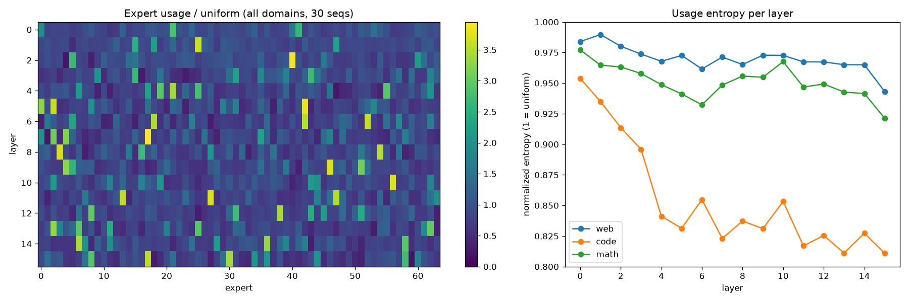

# Step 0: sanity checks

Model `allenai/OLMoE-1B-7B-0125`, bf16, attn=`eager`, experts impl=`grouped_mm`. Config: `{'num_hidden_layers': 16, 'num_experts': 64, 'num_experts_per_tok': 8, 'norm_topk_prob': False, 'num_attention_heads': 16, 'num_key_value_heads': 16, 'hidden_size': 2048}`.

## 1. Load and forward
- Load: 115.9 s, 12.89 GB allocated after load.
- Forward 1x1024 (web), with router logits and attention hooks: peak 13.51 GB, LM loss 2.345.
- Forward 1x2048 (headroom check): peak 14.15 GB of 24 GB.
- Peak memory from `torch.cuda.max_memory_allocated` (nvidia-smi/NVML is broken on this host: driver/library version mismatch; CUDA itself works).

## 2. Router top-8 vs. actual expert choice
- `output_router_logits`: tuple of 16 tensors, each [1024, 64] (torch.bfloat16) = [tokens, experts], pre-softmax.
- Ground truth: `top_k_index` captured by a forward pre-hook on each layer's `mlp.experts`.
- Router (modeling_olmoe.py): softmax(logits) -> top-8; top-8 of softmax == top-8 of logits. `norm_topk_prob=False`, so mixing weights are raw softmax probs (not renormalized); this affects weights only, not the expert set.
- **Set match all layers, all tokens: True**

| layer | set match | weight max abs err | mean sum of top-8 weights |
|---|---|---|---|
| 0 | 1.0000 | 4.86e-04 | 0.361 |
| 1 | 1.0000 | 7.75e-04 | 0.310 |
| 2 | 1.0000 | 5.02e-04 | 0.324 |
| 3 | 1.0000 | 1.89e-03 | 0.344 |
| 4 | 1.0000 | 1.12e-03 | 0.324 |
| 5 | 1.0000 | 8.36e-04 | 0.326 |
| 6 | 1.0000 | 8.97e-04 | 0.334 |
| 7 | 1.0000 | 4.69e-04 | 0.355 |
| 8 | 1.0000 | 1.91e-03 | 0.382 |
| 9 | 1.0000 | 1.86e-03 | 0.420 |
| 10 | 1.0000 | 1.61e-03 | 0.470 |
| 11 | 1.0000 | 1.35e-03 | 0.474 |
| 12 | 1.0000 | 9.42e-04 | 0.514 |
| 13 | 1.0000 | 1.87e-03 | 0.523 |
| 14 | 1.0000 | 1.11e-03 | 0.517 |
| 15 | 1.0000 | 1.21e-03 | 0.505 |

## 3. Attention via hooks
Forward hook on each `self_attn` gets `attn_weights` `[1, H, n, n]` (bf16), reduces it, and returns `None` in its place so the full tensor is freed.

| layer | shape [H,n,n] | max row-sum dev | max upper-tri | mean attn to pos 0 | mean diag |
|---|---|---|---|---|---|
| 0 | [16, 1024, 1024] | 2.93e-03 | 0.0e+00 | 0.024 | 0.115 |
| 1 | [16, 1024, 1024] | 2.50e-03 | 0.0e+00 | 0.013 | 0.080 |
| 2 | [16, 1024, 1024] | 2.93e-03 | 0.0e+00 | 0.065 | 0.068 |
| 3 | [16, 1024, 1024] | 2.49e-03 | 0.0e+00 | 0.132 | 0.043 |
| 4 | [16, 1024, 1024] | 2.69e-03 | 0.0e+00 | 0.162 | 0.060 |
| 5 | [16, 1024, 1024] | 2.79e-03 | 0.0e+00 | 0.276 | 0.068 |
| 6 | [16, 1024, 1024] | 2.68e-03 | 0.0e+00 | 0.236 | 0.059 |
| 7 | [16, 1024, 1024] | 2.45e-03 | 0.0e+00 | 0.304 | 0.085 |
| 8 | [16, 1024, 1024] | 2.45e-03 | 0.0e+00 | 0.262 | 0.044 |
| 9 | [16, 1024, 1024] | 2.65e-03 | 0.0e+00 | 0.368 | 0.032 |
| 10 | [16, 1024, 1024] | 2.73e-03 | 0.0e+00 | 0.357 | 0.029 |
| 11 | [16, 1024, 1024] | 2.85e-03 | 0.0e+00 | 0.354 | 0.074 |
| 12 | [16, 1024, 1024] | 2.86e-03 | 0.0e+00 | 0.507 | 0.034 |
| 13 | [16, 1024, 1024] | 2.89e-03 | 0.0e+00 | 0.533 | 0.029 |
| 14 | [16, 1024, 1024] | 2.81e-03 | 0.0e+00 | 0.569 | 0.041 |
| 15 | [16, 1024, 1024] | 2.70e-03 | 0.0e+00 | 0.385 | 0.074 |

## 4. Expert usage (30 seqs = 10/domain x 1024 tokens)

| layer | unused | max frac | min frac | max/uniform | norm. entropy | web | code | math |
|---|---|---|---|---|---|---|---|---|
| 0 | 0 | 0.0442 | 0.0099 | 2.83 | 0.9866 | 0.9839 | 0.9539 | 0.9772 |
| 1 | 0 | 0.0564 | 0.0081 | 3.61 | 0.9814 | 0.9897 | 0.935 | 0.9647 |
| 2 | 0 | 0.0608 | 0.0038 | 3.89 | 0.9769 | 0.9801 | 0.9136 | 0.9632 |
| 3 | 0 | 0.0422 | 0.0044 | 2.7 | 0.9738 | 0.9737 | 0.8959 | 0.9579 |
| 4 | 0 | 0.0533 | 0.0038 | 3.41 | 0.9615 | 0.9678 | 0.8412 | 0.9488 |
| 5 | 0 | 0.0599 | 0.0053 | 3.83 | 0.9605 | 0.9726 | 0.8313 | 0.9411 |
| 6 | 0 | 0.0562 | 0.0046 | 3.6 | 0.9588 | 0.9616 | 0.8548 | 0.9323 |
| 7 | 0 | 0.0617 | 0.0041 | 3.95 | 0.9598 | 0.9713 | 0.823 | 0.9484 |
| 8 | 0 | 0.0578 | 0.0052 | 3.7 | 0.9659 | 0.9652 | 0.8373 | 0.9557 |
| 9 | 0 | 0.0581 | 0.0057 | 3.72 | 0.9656 | 0.9728 | 0.8311 | 0.9548 |
| 10 | 0 | 0.0584 | 0.0058 | 3.74 | 0.9745 | 0.9727 | 0.8533 | 0.9676 |
| 11 | 0 | 0.0585 | 0.006 | 3.74 | 0.9626 | 0.9673 | 0.817 | 0.9468 |
| 12 | 0 | 0.0538 | 0.0053 | 3.44 | 0.9665 | 0.9673 | 0.8255 | 0.9493 |
| 13 | 0 | 0.0518 | 0.0049 | 3.32 | 0.9612 | 0.9651 | 0.8111 | 0.9427 |
| 14 | 0 | 0.054 | 0.0048 | 3.46 | 0.9643 | 0.965 | 0.8273 | 0.9415 |
| 15 | 0 | 0.0555 | 0.0033 | 3.55 | 0.9553 | 0.9431 | 0.811 | 0.9213 |

## Notes
- Data: 100 docs/domain, one document per sequence, `<|endoftext|>` + first 1023 tokens; shorter docs skipped. web = FineWeb-Edu `sample-10BT`, code = `codeparrot/codeparrot-clean-valid`, math = `open-web-math/open-web-math`, all streamed (no substitutions needed). The tokenizer adds no BOS, hence the prepended `<|endoftext|>`.
- Row-sum deviation (~3e-3) and router weight error (~2e-3) are bf16 rounding: eager attention computes softmax in fp32 then casts to bf16. Upper triangle is exactly 0, so masking is causal.
- Attention to position 0 rises with depth (up to ~0.57 mean in layer 14), so the j=0 exclusion run in Step 1 matters most for late layers.
- Code routing is clearly more concentrated than web/math (norm. entropy ~0.81-0.85 from layer 4 on), so frequency-based baselines will be stronger on code.
- 2048 tokens fit easily (peak ~14 GB); kept 1024 per TASK.md unless the reviewer asks otherwise.
