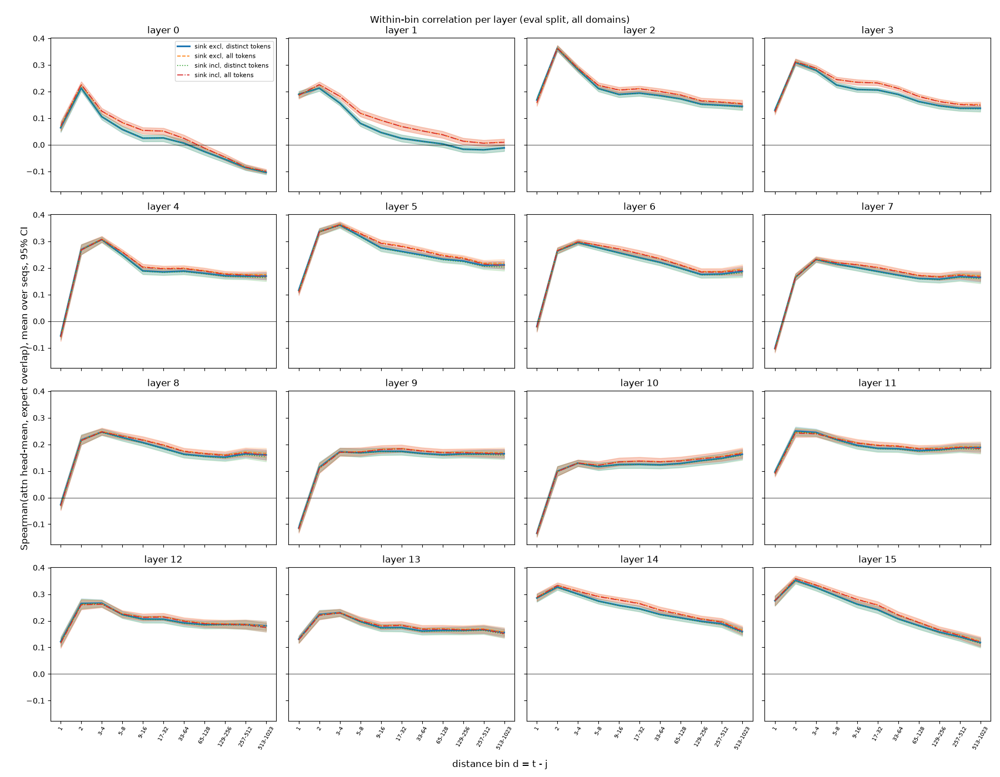
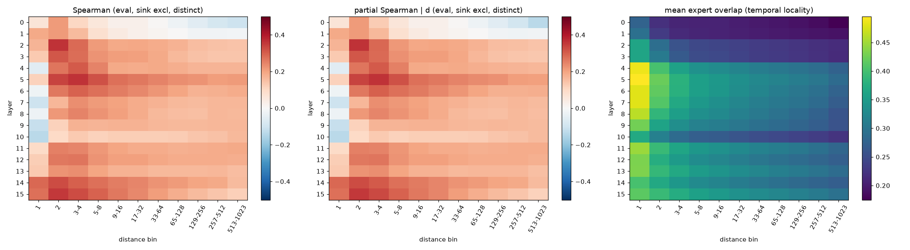
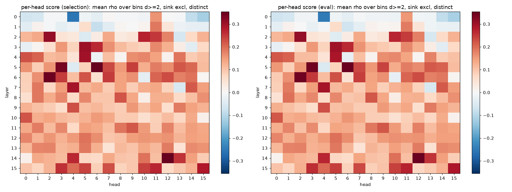
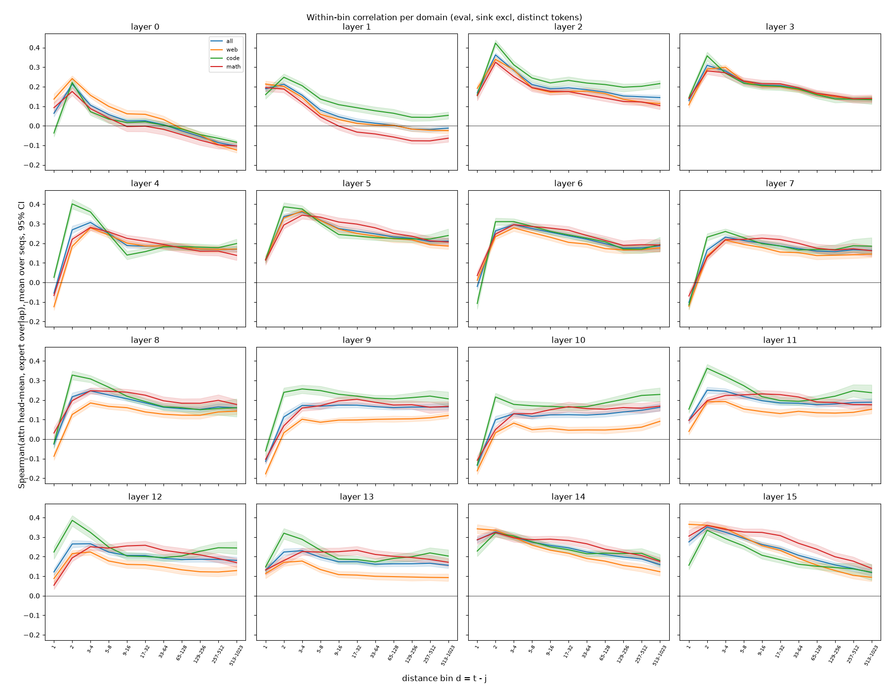
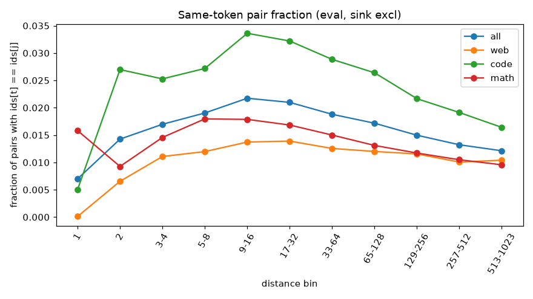

# Step 1 summary: does attention predict expert overlap beyond distance?

**Short answer: yes, moderately, in layers 2–15.** Within a distance bin, the head-mean attention
a(t, j) correlates with the expert overlap |E_t ∩ E_j| / 8 at Spearman ~0.15–0.35 (main variant:
j = 0 excluded, distinct tokens; eval split, 150 sequences). Bootstrap 95% CIs over sequences are about
±0.01–0.02. Layers 0–1 show almost no signal beyond d = 2. Single heads reach ~0.35 averaged over bins.
These are pair-level correlations. Whether they buy prefetch recall over recency and pre-gating is the
Step 2 question.

Full tables: [`STEP1_tables.md`](STEP1_tables.md), `step1_corr.csv` (all splits, domains, layers, bins
and variants, with n_seq and n_pairs per cell), `step1_heads.csv`, `step1_top_heads.csv`,
`step1_best_heads.json` (heads chosen on the selection split, for Step 2).

## Setup (following REVIEW.md)
- 300 sequences x 1024 tokens (100 per domain), split 50/50 into selection and eval sets, stratified by
  domain, seed 0 (`split.json`). All numbers here are on the eval split. Heads were ranked on the
  selection split.
- Expert sets come from the `mlp.experts` pre-hook's `top_k_index`. Attention is gathered inside the
  attention hook for the sampled pairs only.
- Pairs per sequence: all 1023 pairs at d = 1, and 2000 sampled uniformly per bin otherwise. The same
  pairs are used for every layer. The j = 0 and same-token filters are applied after sampling.
- Spearman (average ranks for ties, checked against scipy) is computed per sequence, then averaged over
  sequences, with a 1000-resample bootstrap CI over sequences.
- Extra control beyond the brief: a **partial Spearman given the exact distance d** within each bin.
  This checks that the within-bin variation in d isn't driving the result.

## Headline numbers (eval, all domains, sink excluded, distinct tokens)

Values are mean ρ over bins with d ≥ 2.

| layers | head-mean ρ | partial ρ given d |
|---|---|---|
| 0–1 | 0.02–0.05 | ≈ same (±0.003) |
| 2–8 | 0.18–0.27 (peak: layer 5, 0.268) | same |
| 9–10 | 0.13–0.16 | same |
| 11–15 | 0.18–0.24 | same |

- **Distance profile:** ρ peaks at d = 2–4 (up to 0.36) and decays slowly. It stays at 0.12–0.21 even
  at d = 513–1023 in layers 2–15. Layer 0 turns negative at long range (−0.10).
- **d = 1 is the exception:** ρ is weak or negative in layers 4 and 6–10 (as low as −0.13). Attention
  to the previous token is high for nearly every token, so it doesn't separate tokens with similar and
  different routing. Here overlap is driven by plain locality (mean overlap 0.36–0.50 at d = 1 in layers 2–15), not
  by attention.
- **Domains:** results are similar across domains. Code is slightly higher in middle and late layers
  (e.g. layer 9: web 0.10, code 0.23, math 0.17). Web is the weakest.

## Controls
| sink | tokens | mean ρ (all layers, bins d ≥ 2) |
|---|---|---|
| incl | all | 0.190 |
| incl | distinct | 0.179 |
| excl | all | 0.192 |
| **excl** | **distinct** | **0.181** |

- **Token identity:** same-token pairs are rare, 0.7–2.2% per bin overall and up to 3.4% in code.
  Dropping them lowers ρ by only ~0.01. Repeated tokens are therefore not what drives the signal.
- **Sink:** excluding j = 0 hardly changes pair-level ρ, because uniform sampling draws only ~1 pair
  with j = 0 per 2000 per bin. Those few pairs carry most of the long-range attention mass, though
  (mean attention at d = 513–1023 drops from 0.0009 to 0.0003 without them). The sink exclusion will
  matter much more for Step 2, where attention-weighted scores sum over all j.
- **Distance within the bin:** partial ρ given d is close to raw ρ. Averaged over bins (d ≥ 2) per
  layer they agree within ~0.003. Single (layer, bin) cells differ by up to 0.03 (0.04 within one
  domain). Within a log-spaced bin, distance explains little of the attention–overlap relation.

## Heads

The score is mean ρ over bins with d ≥ 2 (sink excluded, distinct tokens). Heads were ranked on the
selection split; values shown are eval with 95% CI.

| rank | layer.head | eval score | layer head-mean |
|---|---|---|---|
| 1 | 5.6 | 0.350 [0.343, 0.357] | 0.268 |
| 2 | 14.12 | 0.350 [0.343, 0.357] | 0.239 |
| 3 | 6.2 | 0.345 [0.339, 0.352] | 0.229 |
| 4 | 5.3 | 0.344 [0.335, 0.352] | 0.268 |
| 5 | 2.2 | 0.310 [0.303, 0.318] | 0.204 |
| 6–10 | 3.5, 7.4, 4.5, 15.15, 2.10 | 0.27–0.30 | |

- The signal is spread across many heads, with a handful standing out. Most heads in layers 2–15 are
  positive. The best head in a layer beats the head-mean by up to +0.14 (+0.08 to +0.12 in layers 2–7
  and 14). In layers 11–13, though, no single head beats the head-mean (−0.02 to +0.02), so the signal
  there is spread across heads. Results are consistent
  across domains (e.g. head 5.6: web 0.35, code 0.33, math 0.37).
- **Possibly suspicious:** selection and eval rankings agree almost perfectly (Spearman 0.999 over 256
  heads). I checked this, and it isn't leakage. The splits are disjoint documents, and each head score
  averages ~10 bins × ~2000 pairs × 150 sequences. A head's behaviour is a stable property, so a
  near-perfect rank agreement is expected.
- **Negative heads:** head 0.4 is strongly negative (−0.25 on eval; −0.30 on web), and a few layer-0/1 heads are mildly
  negative. These heads attend to tokens whose routing differs, which might be useful as a negative
  feature later, but I haven't investigated it.

## Plots

## Process notes
- `python -m src.run_all` ran end-to-end with exit code 0 (data build skipped, split, Step 0, Step 1;
  ~6 min). Step 0 numbers reproduced exactly; only the load time differs.
- **`data.py` crash on exit:** `del ds; gc.collect()` per domain did *not* fix it (still exit 134). The
  fix used is `os._exit(0)` after saving (`data.hard_exit()`). The rebuilt data is byte-identical
  (same md5).
- A 12-sequence pilot ran first, and its results agree with the full run.
- **Caveats:**
  - Spearman ~0.2 is a modest effect.
  - Expert overlap also carries a strong locality baseline (mean overlap 0.2–0.49 vs 0.125 for random
    sets).
  - Attention and routing both read the same residual stream, so this shows co-variation, not that
    attention causes routing.
  - Prefetch usefulness is untested until Step 2.
