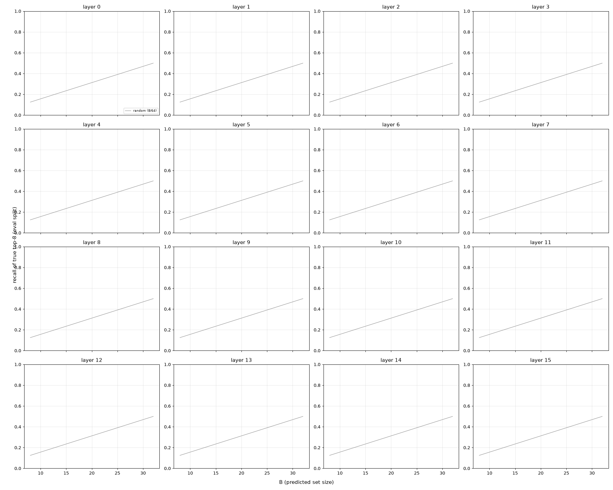
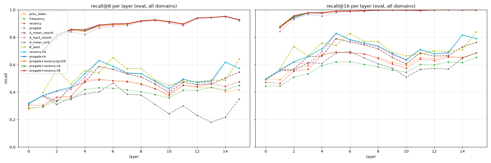

# Step 2 tables (auto-generated)

Eval split (150 seqs) unless stated; tuning on the selection split (150 seqs). Recall averaged over tokens t in [2, 1024). 95% bootstrap CIs over sequences. `avg1-15` = per-sequence mean over layers 1..15 (layer 0 excluded; pre-gating and B are N/A there).

## Lead time

| predictor | reads | available |
|---|---|---|
| oracle_router | layer l router logits (sanity check, not a predictor) | none |
| prev_token | E_{t-1}^l (+ in-seq frequency over j < t to pad) | previous token's step: before token t starts |
| frequency | counts of e in E_j^l, j < t | before token t starts |
| recency | sum_{j<t} lambda^(t-j) 1[e in E_j^l]; lambda tuned per layer | before token t starts |
| pregate | layer l's post_attention_layernorm + gate on the residual entering layer l (= output of layer l-1) | after layer l-1 finishes; covers layer l's attention |
| A_* (same layer) | layer l attention a_l(t, j), j < t, x E_j^l | after layer l's attention softmax; only o_proj + norm before the router |
| B_* (prev layer) | layer l-1 attention a_{l-1}(t, j), j < t, x E_j^l | after layer l-1's attention; covers layer l-1's MoE + layer l's attention |
| recency+A, pregate+A, pregate+recency+A | combination | limited by A: same-layer |
| recency+B, pregate+B, pregate+recency+B | combination | limited by pregate (after layer l-1) or B |
| pregate+recency | combination | after layer l-1 finishes |

## Recall, all domains, average over layers 1-15

| predictor | recall@8 | recall@16 | recall@32 |
|---|---|---|---|
| random | 0.125 | 0.250 | 0.500 |
| oracle_router | 1.000 [1.000, 1.000] | 1.000 [1.000, 1.000] | 1.000 [1.000, 1.000] |
| prev_token | 0.425 [0.417, 0.434] | 0.637 [0.627, 0.650] | 0.843 [0.835, 0.851] |
| frequency | 0.397 [0.383, 0.412] | 0.581 [0.566, 0.597] | 0.816 [0.807, 0.825] |
| recency | 0.434 [0.422, 0.445] | 0.627 [0.615, 0.638] | 0.840 [0.833, 0.848] |
| B_best | 0.522 [0.509, 0.535] | 0.721 [0.710, 0.733] | 0.900 [0.895, 0.905] |
| A_mean_nosink | 0.474 [0.461, 0.487] | 0.683 [0.670, 0.695] | 0.886 [0.879, 0.892] |
| A_top3_nosink | 0.501 [0.489, 0.514] | 0.704 [0.693, 0.715] | 0.895 [0.890, 0.901] |
| A_best | 0.503 [0.489, 0.515] | 0.708 [0.696, 0.720] | 0.898 [0.893, 0.904] |
| A_mean_sink | 0.327 [0.311, 0.341] | 0.607 [0.591, 0.622] | 0.870 [0.861, 0.877] |
| A_top3_sink | 0.391 [0.376, 0.407] | 0.643 [0.628, 0.660] | 0.880 [0.872, 0.887] |
| recency+A | 0.507 [0.495, 0.520] | 0.712 [0.700, 0.723] | 0.898 [0.893, 0.904] |
| recency+B | 0.525 [0.513, 0.538] | 0.725 [0.713, 0.737] | 0.902 [0.896, 0.907] |
| pregate | 0.875 [0.873, 0.877] | 0.976 [0.975, 0.976] | 0.994 [0.994, 0.994] |
| pregate+A | 0.888 [0.886, 0.889] | 0.982 [0.982, 0.983] | 0.996 [0.996, 0.997] |
| pregate+B | 0.888 [0.887, 0.889] | 0.983 [0.983, 0.983] | 0.997 [0.997, 0.997] |
| pregate+recency(grid3) | 0.885 [0.884, 0.887] | 0.982 [0.982, 0.983] | 0.996 [0.996, 0.997] |
| pregate+recency+A | 0.890 [0.888, 0.891] | 0.984 [0.983, 0.984] | 0.997 [0.997, 0.997] |
| pregate+recency+B | 0.890 [0.889, 0.892] | 0.984 [0.984, 0.984] | 0.997 [0.997, 0.997] |

## Recall@8 per layer (all domains)

| layer | oracle_router | prev_token | frequency | recency | B_best | A_mean_nosink | A_top3_nosink | A_best | A_mean_sink | A_top3_sink | recency+A | recency+B | pregate | pregate+A | pregate+B | pregate+recency(grid3) | pregate+recency+A | pregate+recency+B |
|---|---|---|---|---|---|---|---|---|---|---|---|---|---|---|---|---|---|---|
| 0 | 1.000 | 0.278 | 0.287 | 0.306 | N/A | 0.317 | 0.322 | 0.317 | 0.314 | 0.321 | 0.320 | N/A | N/A | N/A | N/A | N/A | N/A | N/A |
| 1 | 1.000 | 0.295 | 0.293 | 0.306 | 0.397 | 0.376 | 0.370 | 0.376 | 0.375 | 0.370 | 0.376 | 0.397 | 0.670 | 0.705 | 0.703 | 0.691 | 0.704 | 0.702 |
| 2 | 1.000 | 0.364 | 0.340 | 0.363 | 0.563 | 0.333 | 0.406 | 0.406 | 0.311 | 0.393 | 0.411 | 0.560 | 0.788 | 0.802 | 0.820 | 0.808 | 0.812 | 0.822 |
| 3 | 1.000 | 0.364 | 0.347 | 0.372 | 0.461 | 0.436 | 0.423 | 0.436 | 0.357 | 0.387 | 0.436 | 0.461 | 0.840 | 0.852 | 0.849 | 0.854 | 0.858 | 0.857 |
| 4 | 1.000 | 0.489 | 0.421 | 0.478 | 0.558 | 0.473 | 0.507 | 0.507 | 0.388 | 0.450 | 0.536 | 0.585 | 0.821 | 0.848 | 0.842 | 0.844 | 0.857 | 0.857 |
| 5 | 1.000 | 0.497 | 0.432 | 0.491 | 0.542 | 0.588 | 0.631 | 0.631 | 0.403 | 0.597 | 0.631 | 0.550 | 0.867 | 0.888 | 0.887 | 0.881 | 0.890 | 0.890 |
| 6 | 1.000 | 0.483 | 0.430 | 0.484 | 0.652 | 0.567 | 0.589 | 0.589 | 0.466 | 0.536 | 0.589 | 0.651 | 0.882 | 0.898 | 0.898 | 0.892 | 0.898 | 0.898 |
| 7 | 1.000 | 0.483 | 0.417 | 0.475 | 0.571 | 0.534 | 0.535 | 0.535 | 0.386 | 0.453 | 0.541 | 0.573 | 0.886 | 0.897 | 0.898 | 0.896 | 0.899 | 0.899 |
| 8 | 1.000 | 0.464 | 0.402 | 0.457 | 0.573 | 0.511 | 0.534 | 0.534 | 0.380 | 0.421 | 0.536 | 0.578 | 0.913 | 0.920 | 0.919 | 0.917 | 0.920 | 0.920 |
| 9 | 1.000 | 0.429 | 0.383 | 0.424 | 0.490 | 0.460 | 0.479 | 0.479 | 0.311 | 0.358 | 0.482 | 0.491 | 0.921 | 0.927 | 0.927 | 0.925 | 0.928 | 0.928 |
| 10 | 1.000 | 0.372 | 0.359 | 0.382 | 0.451 | 0.396 | 0.413 | 0.413 | 0.243 | 0.221 | 0.428 | 0.451 | 0.904 | 0.913 | 0.915 | 0.914 | 0.915 | 0.916 |
| 11 | 1.000 | 0.449 | 0.415 | 0.453 | 0.479 | 0.473 | 0.493 | 0.493 | 0.301 | 0.333 | 0.495 | 0.480 | 0.885 | 0.897 | 0.897 | 0.894 | 0.897 | 0.897 |
| 12 | 1.000 | 0.435 | 0.414 | 0.442 | 0.476 | 0.457 | 0.471 | 0.471 | 0.231 | 0.243 | 0.471 | 0.476 | 0.936 | 0.941 | 0.941 | 0.940 | 0.941 | 0.941 |
| 13 | 1.000 | 0.434 | 0.435 | 0.462 | 0.488 | 0.460 | 0.474 | 0.474 | 0.181 | 0.234 | 0.482 | 0.488 | 0.943 | 0.945 | 0.944 | 0.944 | 0.945 | 0.945 |
| 14 | 1.000 | 0.404 | 0.417 | 0.443 | 0.488 | 0.503 | 0.619 | 0.619 | 0.218 | 0.418 | 0.619 | 0.493 | 0.950 | 0.953 | 0.952 | 0.952 | 0.953 | 0.952 |
| 15 | 1.000 | 0.417 | 0.451 | 0.476 | 0.642 | 0.547 | 0.574 | 0.574 | 0.351 | 0.456 | 0.574 | 0.642 | 0.921 | 0.928 | 0.929 | 0.927 | 0.928 | 0.929 |

## Recall@16 per layer (all domains)

| layer | oracle_router | prev_token | frequency | recency | B_best | A_mean_nosink | A_top3_nosink | A_best | A_mean_sink | A_top3_sink | recency+A | recency+B | pregate | pregate+A | pregate+B | pregate+recency(grid3) | pregate+recency+A | pregate+recency+B |
|---|---|---|---|---|---|---|---|---|---|---|---|---|---|---|---|---|---|---|
| 0 | 1.000 | 0.494 | 0.445 | 0.471 | N/A | 0.496 | 0.491 | 0.496 | 0.491 | 0.491 | 0.496 | N/A | N/A | N/A | N/A | N/A | N/A | N/A |
| 1 | 1.000 | 0.492 | 0.446 | 0.465 | 0.570 | 0.562 | 0.553 | 0.562 | 0.561 | 0.552 | 0.562 | 0.570 | 0.843 | 0.878 | 0.877 | 0.868 | 0.878 | 0.877 |
| 2 | 1.000 | 0.571 | 0.510 | 0.554 | 0.734 | 0.566 | 0.619 | 0.619 | 0.557 | 0.608 | 0.622 | 0.736 | 0.931 | 0.942 | 0.955 | 0.950 | 0.952 | 0.957 |
| 3 | 1.000 | 0.593 | 0.533 | 0.567 | 0.663 | 0.660 | 0.607 | 0.660 | 0.616 | 0.583 | 0.660 | 0.663 | 0.966 | 0.977 | 0.976 | 0.978 | 0.979 | 0.979 |
| 4 | 1.000 | 0.676 | 0.595 | 0.669 | 0.758 | 0.663 | 0.698 | 0.698 | 0.610 | 0.661 | 0.717 | 0.778 | 0.954 | 0.975 | 0.972 | 0.976 | 0.978 | 0.980 |
| 5 | 1.000 | 0.694 | 0.620 | 0.691 | 0.742 | 0.790 | 0.827 | 0.827 | 0.686 | 0.789 | 0.830 | 0.754 | 0.981 | 0.991 | 0.990 | 0.989 | 0.992 | 0.991 |
| 6 | 1.000 | 0.689 | 0.622 | 0.687 | 0.829 | 0.767 | 0.782 | 0.782 | 0.695 | 0.734 | 0.784 | 0.831 | 0.988 | 0.992 | 0.992 | 0.991 | 0.992 | 0.992 |
| 7 | 1.000 | 0.680 | 0.602 | 0.679 | 0.771 | 0.745 | 0.751 | 0.751 | 0.651 | 0.681 | 0.759 | 0.775 | 0.990 | 0.994 | 0.994 | 0.993 | 0.994 | 0.994 |
| 8 | 1.000 | 0.652 | 0.585 | 0.645 | 0.769 | 0.716 | 0.732 | 0.732 | 0.607 | 0.647 | 0.737 | 0.777 | 0.997 | 0.998 | 0.998 | 0.998 | 0.998 | 0.998 |
| 9 | 1.000 | 0.619 | 0.562 | 0.606 | 0.690 | 0.653 | 0.674 | 0.674 | 0.576 | 0.605 | 0.682 | 0.694 | 0.998 | 0.999 | 0.999 | 0.998 | 0.999 | 0.999 |
| 10 | 1.000 | 0.595 | 0.546 | 0.575 | 0.666 | 0.606 | 0.633 | 0.633 | 0.511 | 0.546 | 0.637 | 0.666 | 0.996 | 0.998 | 0.998 | 0.998 | 0.998 | 0.998 |
| 11 | 1.000 | 0.653 | 0.602 | 0.640 | 0.678 | 0.686 | 0.710 | 0.710 | 0.567 | 0.606 | 0.712 | 0.679 | 0.994 | 0.996 | 0.996 | 0.995 | 0.996 | 0.996 |
| 12 | 1.000 | 0.645 | 0.598 | 0.631 | 0.701 | 0.664 | 0.679 | 0.679 | 0.573 | 0.589 | 0.679 | 0.701 | 0.999 | 1.000 | 1.000 | 1.000 | 1.000 | 1.000 |
| 13 | 1.000 | 0.664 | 0.621 | 0.656 | 0.698 | 0.667 | 0.685 | 0.685 | 0.568 | 0.582 | 0.689 | 0.698 | 1.000 | 1.000 | 1.000 | 1.000 | 1.000 | 1.000 |
| 14 | 1.000 | 0.654 | 0.617 | 0.650 | 0.710 | 0.730 | 0.816 | 0.816 | 0.647 | 0.736 | 0.816 | 0.711 | 1.000 | 1.000 | 1.000 | 1.000 | 1.000 | 1.000 |
| 15 | 1.000 | 0.684 | 0.654 | 0.688 | 0.841 | 0.763 | 0.791 | 0.791 | 0.687 | 0.732 | 0.791 | 0.841 | 0.998 | 0.999 | 0.999 | 0.999 | 0.999 | 0.999 |

## Per domain, average over layers 1-15

| predictor | web @8 | code @8 | math @8 | web @16 | code @16 | math @16 |
|---|---|---|---|---|---|---|
| oracle_router | 1.000 | 1.000 | 1.000 | 1.000 | 1.000 | 1.000 |
| prev_token | 0.368 | 0.468 | 0.439 | 0.572 | 0.711 | 0.630 |
| frequency | 0.315 | 0.493 | 0.383 | 0.502 | 0.681 | 0.560 |
| recency | 0.357 | 0.508 | 0.436 | 0.552 | 0.702 | 0.626 |
| B_best | 0.439 | 0.605 | 0.522 | 0.650 | 0.796 | 0.719 |
| A_mean_nosink | 0.388 | 0.558 | 0.477 | 0.603 | 0.763 | 0.682 |
| A_top3_nosink | 0.419 | 0.582 | 0.502 | 0.632 | 0.777 | 0.703 |
| A_best | 0.419 | 0.585 | 0.504 | 0.634 | 0.783 | 0.707 |
| A_mean_sink | 0.221 | 0.427 | 0.332 | 0.498 | 0.714 | 0.610 |
| A_top3_sink | 0.298 | 0.480 | 0.396 | 0.547 | 0.739 | 0.645 |
| recency+A | 0.426 | 0.586 | 0.510 | 0.641 | 0.784 | 0.711 |
| recency+B | 0.445 | 0.604 | 0.526 | 0.656 | 0.797 | 0.723 |
| pregate | 0.887 | 0.861 | 0.877 | 0.980 | 0.971 | 0.976 |
| pregate+A | 0.893 | 0.880 | 0.890 | 0.983 | 0.981 | 0.983 |
| pregate+B | 0.893 | 0.881 | 0.891 | 0.984 | 0.982 | 0.984 |
| pregate+recency(grid3) | 0.892 | 0.875 | 0.888 | 0.983 | 0.980 | 0.983 |
| pregate+recency+A | 0.895 | 0.881 | 0.892 | 0.985 | 0.982 | 0.985 |
| pregate+recency+B | 0.895 | 0.882 | 0.893 | 0.985 | 0.982 | 0.985 |

## Gains (paired per sequence, eval)

| comparison | a - b | domain | gain@8 [95% CI] | gain@16 [95% CI] |
|---|---|---|---|---|
| attention alone vs recency | A_best - recency | all | +0.0687 [+0.0662, +0.0714] | +0.0811 [+0.0785, +0.0838] |
| attention alone vs recency | A_best - recency | web | +0.0616 [+0.0570, +0.0663] | +0.0814 [+0.0770, +0.0856] |
| attention alone vs recency | A_best - recency | code | +0.0768 [+0.0729, +0.0809] | +0.0816 [+0.0767, +0.0870] |
| attention alone vs recency | A_best - recency | math | +0.0677 [+0.0632, +0.0725] | +0.0804 [+0.0758, +0.0854] |
| attention adds to recency | recency+A - recency | all | +0.0734 [+0.0710, +0.0757] | +0.0849 [+0.0823, +0.0876] |
| attention adds to recency | recency+A - recency | web | +0.0692 [+0.0658, +0.0729] | +0.0884 [+0.0848, +0.0921] |
| attention adds to recency | recency+A - recency | code | +0.0774 [+0.0737, +0.0810] | +0.0818 [+0.0771, +0.0864] |
| attention adds to recency | recency+A - recency | math | +0.0735 [+0.0690, +0.0773] | +0.0846 [+0.0801, +0.0890] |
| attention (same layer) adds to pre-gating | pregate+A - pregate | all | +0.0123 [+0.0114, +0.0133] | +0.0067 [+0.0063, +0.0072] |
| attention (same layer) adds to pre-gating | pregate+A - pregate | web | +0.0056 [+0.0050, +0.0064] | +0.0035 [+0.0031, +0.0038] |
| attention (same layer) adds to pre-gating | pregate+A - pregate | code | +0.0184 [+0.0177, +0.0192] | +0.0096 [+0.0093, +0.0100] |
| attention (same layer) adds to pre-gating | pregate+A - pregate | math | +0.0130 [+0.0116, +0.0144] | +0.0071 [+0.0065, +0.0078] |
| attention (prev layer) adds to pre-gating | pregate+B - pregate | all | +0.0130 [+0.0119, +0.0140] | +0.0073 [+0.0068, +0.0078] |
| attention (prev layer) adds to pre-gating | pregate+B - pregate | web | +0.0057 [+0.0049, +0.0065] | +0.0039 [+0.0035, +0.0043] |
| attention (prev layer) adds to pre-gating | pregate+B - pregate | code | +0.0198 [+0.0190, +0.0207] | +0.0105 [+0.0101, +0.0109] |
| attention (prev layer) adds to pre-gating | pregate+B - pregate | math | +0.0134 [+0.0118, +0.0150] | +0.0075 [+0.0068, +0.0081] |
| attention (same layer) adds to pre-gating+recency | pregate+recency+A - pregate+recency(grid3) | all | +0.0043 [+0.0041, +0.0045] | +0.0015 [+0.0014, +0.0016] |
| attention (same layer) adds to pre-gating+recency | pregate+recency+A - pregate+recency(grid3) | web | +0.0033 [+0.0031, +0.0035] | +0.0012 [+0.0011, +0.0013] |
| attention (same layer) adds to pre-gating+recency | pregate+recency+A - pregate+recency(grid3) | code | +0.0057 [+0.0053, +0.0061] | +0.0020 [+0.0018, +0.0021] |
| attention (same layer) adds to pre-gating+recency | pregate+recency+A - pregate+recency(grid3) | math | +0.0039 [+0.0036, +0.0042] | +0.0012 [+0.0011, +0.0013] |
| attention (prev layer) adds to pre-gating+recency | pregate+recency+B - pregate+recency(grid3) | all | +0.0049 [+0.0046, +0.0052] | +0.0018 [+0.0017, +0.0020] |
| attention (prev layer) adds to pre-gating+recency | pregate+recency+B - pregate+recency(grid3) | web | +0.0034 [+0.0031, +0.0036] | +0.0012 [+0.0011, +0.0013] |
| attention (prev layer) adds to pre-gating+recency | pregate+recency+B - pregate+recency(grid3) | code | +0.0069 [+0.0065, +0.0074] | +0.0028 [+0.0026, +0.0030] |
| attention (prev layer) adds to pre-gating+recency | pregate+recency+B - pregate+recency(grid3) | math | +0.0044 [+0.0040, +0.0048] | +0.0014 [+0.0012, +0.0015] |
| attention (same layer) vs pre-gating | A_best - pregate | all | -0.3727 [-0.3875, -0.3573] | -0.2677 [-0.2796, -0.2549] |
| attention (same layer) vs pre-gating | A_best - pregate | web | -0.4684 [-0.4762, -0.4598] | -0.3458 [-0.3541, -0.3368] |
| attention (same layer) vs pre-gating | A_best - pregate | code | -0.2762 [-0.2827, -0.2693] | -0.1877 [-0.1944, -0.1807] |
| attention (same layer) vs pre-gating | A_best - pregate | math | -0.3734 [-0.3924, -0.3530] | -0.2695 [-0.2855, -0.2512] |
| recency adds to pre-gating | pregate+recency(grid3) - pregate | all | +0.0101 [+0.0094, +0.0109] | +0.0065 [+0.0061, +0.0069] |
| recency adds to pre-gating | pregate+recency(grid3) - pregate | web | +0.0051 [+0.0045, +0.0058] | +0.0037 [+0.0033, +0.0041] |
| recency adds to pre-gating | pregate+recency(grid3) - pregate | code | +0.0139 [+0.0135, +0.0144] | +0.0085 [+0.0082, +0.0088] |
| recency adds to pre-gating | pregate+recency(grid3) - pregate | math | +0.0113 [+0.0100, +0.0124] | +0.0072 [+0.0066, +0.0078] |
| top-3 heads vs head-mean (A) | A_top3_nosink - A_mean_nosink | all | +0.0270 [+0.0262, +0.0279] | +0.0211 [+0.0199, +0.0224] |
| top-3 heads vs head-mean (A) | A_top3_nosink - A_mean_nosink | web | +0.0311 [+0.0296, +0.0325] | +0.0285 [+0.0274, +0.0295] |
| top-3 heads vs head-mean (A) | A_top3_nosink - A_mean_nosink | code | +0.0243 [+0.0232, +0.0254] | +0.0140 [+0.0132, +0.0150] |
| top-3 heads vs head-mean (A) | A_top3_nosink - A_mean_nosink | math | +0.0256 [+0.0242, +0.0269] | +0.0209 [+0.0190, +0.0226] |
| sink excluded vs included (A, head-mean) | A_mean_nosink - A_mean_sink | all | +0.1475 [+0.1438, +0.1518] | +0.0753 [+0.0714, +0.0794] |
| sink excluded vs included (A, head-mean) | A_mean_nosink - A_mean_sink | web | +0.1671 [+0.1619, +0.1725] | +0.1052 [+0.1015, +0.1091] |
| sink excluded vs included (A, head-mean) | A_mean_nosink - A_mean_sink | code | +0.1307 [+0.1243, +0.1383] | +0.0491 [+0.0466, +0.0514] |
| sink excluded vs included (A, head-mean) | A_mean_nosink - A_mean_sink | math | +0.1447 [+0.1388, +0.1510] | +0.0718 [+0.0669, +0.0765] |

## Per-layer gains at B = 8 (all domains)

| layer | attention adds to recency | attention (same layer) adds to pre-gating | attention (same layer) adds to pre-gating+recency | attention (prev layer) adds to pre-gating+recency |
|---|---|---|---|---|
| 0 | +0.0141 [+0.0128, +0.0153] | N/A | N/A | N/A |
| 1 | +0.0704 [+0.0677, +0.0730] | +0.0351 [+0.0318, +0.0387] | +0.0125 [+0.0118, +0.0131] | +0.0105 [+0.0097, +0.0112] |
| 2 | +0.0481 [+0.0398, +0.0561] | +0.0140 [+0.0123, +0.0157] | +0.0033 [+0.0030, +0.0037] | +0.0139 [+0.0126, +0.0153] |
| 3 | +0.0650 [+0.0566, +0.0725] | +0.0121 [+0.0103, +0.0140] | +0.0035 [+0.0032, +0.0039] | +0.0030 [+0.0027, +0.0033] |
| 4 | +0.0581 [+0.0555, +0.0605] | +0.0261 [+0.0229, +0.0298] | +0.0128 [+0.0122, +0.0134] | +0.0132 [+0.0123, +0.0142] |
| 5 | +0.1406 [+0.1344, +0.1467] | +0.0208 [+0.0191, +0.0226] | +0.0091 [+0.0085, +0.0097] | +0.0085 [+0.0081, +0.0090] |
| 6 | +0.1051 [+0.1016, +0.1081] | +0.0154 [+0.0143, +0.0166] | +0.0058 [+0.0051, +0.0064] | +0.0060 [+0.0050, +0.0070] |
| 7 | +0.0656 [+0.0628, +0.0685] | +0.0113 [+0.0097, +0.0130] | +0.0031 [+0.0025, +0.0037] | +0.0035 [+0.0029, +0.0041] |
| 8 | +0.0786 [+0.0759, +0.0811] | +0.0074 [+0.0069, +0.0080] | +0.0028 [+0.0025, +0.0031] | +0.0028 [+0.0024, +0.0033] |
| 9 | +0.0577 [+0.0551, +0.0604] | +0.0056 [+0.0050, +0.0062] | +0.0022 [+0.0019, +0.0025] | +0.0024 [+0.0021, +0.0027] |
| 10 | +0.0457 [+0.0409, +0.0505] | +0.0088 [+0.0081, +0.0095] | +0.0015 [+0.0013, +0.0018] | +0.0019 [+0.0016, +0.0022] |
| 11 | +0.0423 [+0.0388, +0.0458] | +0.0116 [+0.0105, +0.0128] | +0.0033 [+0.0026, +0.0039] | +0.0032 [+0.0027, +0.0037] |
| 12 | +0.0292 [+0.0255, +0.0329] | +0.0043 [+0.0039, +0.0047] | +0.0011 [+0.0009, +0.0014] | +0.0012 [+0.0010, +0.0014] |
| 13 | +0.0197 [+0.0166, +0.0229] | +0.0022 [+0.0018, +0.0026] | +0.0005 [+0.0003, +0.0007] | +0.0003 [+0.0001, +0.0005] |
| 14 | +0.1762 [+0.1691, +0.1826] | +0.0032 [+0.0027, +0.0037] | +0.0014 [+0.0012, +0.0017] | +0.0007 [+0.0005, +0.0009] |
| 15 | +0.0982 [+0.0920, +0.1046] | +0.0071 [+0.0064, +0.0079] | +0.0015 [+0.0010, +0.0020] | +0.0021 [+0.0017, +0.0025] |

## Tuned parameters (selection split)

| layer | lambda | A heads | B heads (of layer l-1) | recency+A w_A | pregate+A w_A | pregate+recency+A (wP,wR,wA) | pregate+recency+B (wP,wR,wB) | pregate+recency (wP,wR) |
|---|---|---|---|---|---|---|---|---|
| 0 | 0.95 | mean | None | 0.8 | None | None | None | None |
| 1 | 0.95 | mean | [15, 14, 11] | 1.0 | 0.2 | [0.78, 0.02, 0.2] | [0.78, 0.02, 0.2] | [0.8, 0.2] |
| 2 | 0.8 | top3 | [4, 8, 11] | 0.9 | 0.15 | [0.8, 0.15, 0.05] | [0.775, 0.075, 0.15] | [0.85, 0.15] |
| 3 | 0.9 | mean | [2, 10, 0] | 1.0 | 0.15 | [0.85, 0.1, 0.05] | [0.85, 0.1, 0.05] | [0.85, 0.15] |
| 4 | 0.7 | top3 | [12, 15, 7] | 0.6 | 0.2 | [0.8, 0.1, 0.1] | [0.75, 0.15, 0.1] | [0.8, 0.2] |
| 5 | 0.7 | top3 | [1, 0, 15] | 0.9 | 0.15 | [0.825, 0.075, 0.1] | [0.85, 0.05, 0.1] | [0.85, 0.15] |
| 6 | 0.7 | top3 | [3, 7, 6] | 0.9 | 0.1 | [0.88, 0.02, 0.1] | [0.87, 0.03, 0.1] | [0.925, 0.075] |
| 7 | 0.7 | top3 | [2, 3, 12] | 0.8 | 0.1 | [0.895, 0.03, 0.075] | [0.895, 0.03, 0.075] | [0.925, 0.075] |
| 8 | 0.7 | top3 | [10, 4, 15] | 0.8 | 0.05 | [0.93, 0.02, 0.05] | [0.93, 0.02, 0.05] | [0.95, 0.05] |
| 9 | 0.7 | top3 | [8, 11, 2] | 0.8 | 0.05 | [0.95, 0.02, 0.03] | [0.95, 0.02, 0.03] | [0.97, 0.03] |
| 10 | 0.95 | top3 | [4, 13, 6] | 0.7 | 0.05 | [0.92, 0.05, 0.03] | [0.92, 0.03, 0.05] | [0.925, 0.075] |
| 11 | 0.7 | top3 | [15, 7, 14] | 0.9 | 0.075 | [0.905, 0.02, 0.075] | [0.915, 0.01, 0.075] | [0.925, 0.075] |
| 12 | 0.9 | top3 | [9, 8, 6] | 1.0 | 0.03 | [0.96, 0.01, 0.03] | [0.96, 0.01, 0.03] | [0.97, 0.03] |
| 13 | 0.9 | top3 | [5, 2, 0] | 0.7 | 0.03 | [0.97, 0.01, 0.02] | [0.97, 0.01, 0.02] | [0.98, 0.02] |
| 14 | 0.95 | top3 | [12, 15, 14] | 1.0 | 0.03 | [0.97, 0.0, 0.03] | [0.97, 0.01, 0.02] | [0.97, 0.03] |
| 15 | 0.95 | top3 | [4, 13, 12] | 1.0 | 0.05 | [0.93, 0.02, 0.05] | [0.93, 0.02, 0.05] | [0.95, 0.05] |

